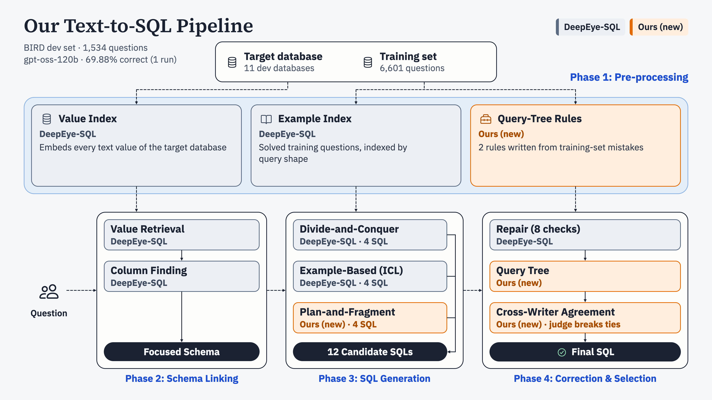

# Trident-SQL

Text-to-SQL pipeline for the BIRD benchmark: turns a question in English into an SQL query for a given database.

## Pipeline



## Repository index

| path | what it holds |
|---|---|
| `pipeline.py` | runs every stage in order, then the score |
| `run_all.sh` | one command for setup and the full run |
| `pipeline.env.example` | template for the machine settings (work folder, GPUs) |
| `requirements.lock` | pinned Python packages |
| `configs/` | model and stage settings, in one file |
| `serving/` | starts the model server (vLLM) |
| `stage0_dataset/` | reads BIRD dev; builds per-database facts |
| `stage1_value_finding/` | finds stored database values that match words in the question |
| `stage2_similar_examples/` | finds solved training questions similar to this one |
| `stage3_column_finding/` | picks the tables and columns the SQL needs |
| `stage4_generation/` | writes candidate SQL (divide-and-conquer, few-shot, Plan-and-Fragment) |
| `stage5_repair/` | checks each SQL and rewrites the ones that fail |
| `stage6_query_tree/` | rule-guided repair using the SQL's structure |
| `stage7_selection/` | runs every SQL and picks the final answer |
| `stage8_scoring/` | BIRD execution accuracy |
| `common/` | code shared by all stages |
| `assets/` | the pipeline flow chart above |
| `NOTICE` | licence of the third-party code the base stages are adapted from |

## Run end to end

Needs Linux, 2 NVIDIA GPUs with 80 GB each (A100 or H100), about 200 GB free disk, and internet for setup.

```bash
cp pipeline.env.example pipeline.env   # set WORK (a folder with ~200 GB free) and GPUS
bash run_all.sh setup                  # Python environment, models, BIRD data
bash run_all.sh run                    # model server + every stage + score; rerun to resume
```

The score is written to `<WORK>/runs/<RUN_NAME>/variants/final_qtree_wv.score.txt`.
